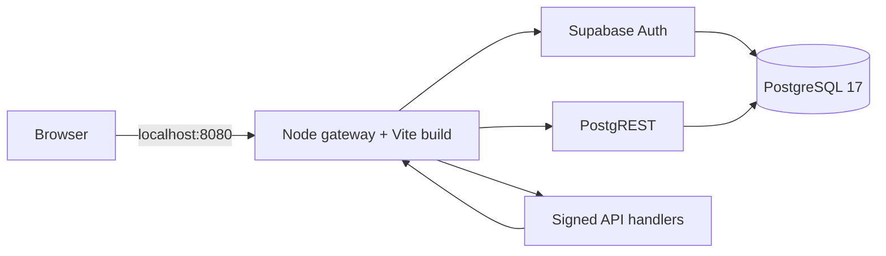

<div align="center">

# Smart Agro

**Observe the plant. Understand the evidence. Choose the next step.**

An interactive plant-care simulator and local IoT backend for traceable observations, product ownership, and evidence-based decisions.

[Get started](#get-started) · [Explore the app](#explore-the-app) · [Architecture](#architecture) · [Contributing](CONTRIBUTING.md)


</div>

Smart Agro connects a scroll-driven plant story with a working simulator and a separate authenticated product workspace. The interface is in Indonesian. The simulator runs offline in the browser; Docker adds PostgreSQL, authentication, signed telemetry ingestion, profile curation, and program rewards.

## Get started

Install [Docker Desktop](https://www.docker.com/products/docker-desktop/) with Linux containers and Compose v2 or newer. Run from the repository root:

```sh
git clone https://github.com/Maliq-dlt/Smart-Argo.git
cd Smart-Argo
docker compose up --build -d --wait
```

Open **[http://127.0.0.1:8088](http://127.0.0.1:8088)**. No host Node.js, Python, Supabase account, or manual `.env` setup is required. The first build downloads images and dependencies.

```sh
# Check actual services, compiled assets, authentication and access controls
docker compose --profile tools run --rm verify

# Inspect services
docker compose ps -a

# Stop while preserving data and generated keys
docker compose stop

# Resume
docker compose up -d --wait
```

Database data and generated credentials persist in separate named volumes. `docker compose down` also preserves these volumes. Removing volumes erases the local installation; retain both when backing up or moving it. Only port `8080` is published, on loopback.

Local assessment mode automatically confirms new registrations. It sends no verification email and does not establish mailbox ownership. This Compose setup is intended for local assessment and development.

## Explore the app

1. **Choose a plant.** Select cabai or bawang, lock the specimen, and scroll through five chapters. GSAP changes its scale, angle, and composition; keyboard controls and reduced motion remain available.
2. **Try a care decision.** Compare drying and persistently wet observations, then open **Coba simulator**. Plant a seed, change scenarios, advance time, water, or record a fertilizer reminder.
3. **Read the history.** Open Dashboard or Terminal for sensor trends, decision evidence, and the journal. Export a session before clearing browser storage.
4. **Open Ekosistem.** Register in **Akun & kepemilikan produk online**. Browser-local ecosystem demos and online account records use separate data stores.
5. **Exercise device workflows.** Activation requires a provisioned product, sealed activation code, and Ed25519 signature. Integration tests provision software fixtures and verify the protocol. A fresh database contains no fabricated devices or readings.


## What is implemented

| Area | Current behavior |
| --- | --- |
| Plant story | Cabai/bawang selection, locked specimen, reversible GSAP scroll composition, reduced motion. |
| Simulator | Deterministic rules, timestamped readings, reproducible scenarios, planting/watering effects, reminders, session import/export and comparisons. |
| Accounts and ownership | Email/password Auth, private owner reads, session-bound activation challenges, Ed25519 verification, transactional claims and RLS. |
| Device telemetry | Signed v2 envelopes, sensor quality, sequence/replay protection, bounded history, explicit stale/missing readings. |
| Community knowledge | Contributions, curator review, immutable profile versions, evidence/scope, no self-approval. |
| Explanations | Deterministic rule evidence and saved explanations. Generative AI is not configured. |
| Energy and rewards | Signed meter evidence, server policies, transactional ledger/reservations and program redemptions. |
| Audit outbox | Atomic pending jobs and verifiable commitments. No blockchain network or contract is configured. |

Tests use generated keys and synthetic observations. They do not establish calibration, field accuracy, actuator operation, actual energy savings, or physical-device integration. Rewards are internal program records, not money or cryptocurrency. Plant images are 2.5D cutouts rather than freely rotatable 3D models.

## Architecture



The gateway serves compiled web assets and same-origin APIs. Four TypeScript handlers verify product claims, plant telemetry, rule explanations, and energy evidence. Auth and PostgREST reach PostgreSQL on the private Compose network. Initialization generates credentials once; versioned migrations run transactionally before the app becomes ready.

The browser receives only its API origin and public anonymous key through `runtime-config.js`. Database passwords, JWT signing material and service-role keys stay on the backend. The runtime uses an unprivileged Node user, without `node_modules` or frontend build tools.

```text
src/components/        Landing, simulator, dashboards, product workspace
src/lib/               Rules, sessions, protocol clients and validation
supabase/functions/    Request handlers and signature verification
supabase/migrations/   Schema, RLS and transactional operations
scripts/               Shared gateway, local launcher, Python reference
tests/                Unit, integration, container and browser checks
docs/                 Protocols, implementation evidence and diagrams
```

Stack: React 18, TypeScript, Vite, Tailwind CSS, Radix UI, GSAP, Framer Motion, Node.js, PostgreSQL, Supabase Auth and PostgREST. Scrolling uses native browser scrolling with GSAP ScrollTrigger/ScrollTo; Lenis is not used.

## Local development

Use Node.js **22.18+**, npm, and Python **3.10+** for parity tests.

```sh
npm ci --cache .cache/npm
npm run dev
```

Open [http://127.0.0.1:5173](http://127.0.0.1:5173). The simulator needs no backend. For online features, run `npm run backend:local` in another terminal first, then start/restart Vite. This separate developer stack uses ports `54321`, `54324`, `54325` and the `smart-agro-phase1` Compose project.

The launcher creates `.env.local` only if absent. It preserves existing configuration; public local values are also written to `.tmp/phase1/browser.env`. Keep generated environment files and `.tmp/` out of Git. See [implementation phases](docs/IMPLEMENTATION_PHASES.md) for provisioning and hosted Supabase setup.

For static hosting, run `npm run build` and publish `dist/`. Configure `VITE_SUPABASE_URL` and `VITE_SUPABASE_ANON_KEY` at build time for online features. Static hosting does not include the Docker backend. Never put service-role keys in a `VITE_` variable.

## Verification

```sh
npm run lint
npm run typecheck
npm test
npm run build
python scripts/reference/simulasi_pot.py --self-test
```

Unit checks include decision/evidence parity with the bundled Python reference across 110 cases. Backend integration checks cover ownership, denied access, replay/concurrency, rollback, curation, explanations, signed energy and reward accounting:

```sh
# Start npm run backend:local in a separate terminal first
npm run test:backend
```

These tests target the isolated developer stack. They create synthetic accounts/products and briefly install rollback-test triggers. Do not run them against a shared or production database.

Browser checks use an existing Playwright installation and Google Chrome. PowerShell example against Docker:

```powershell
$env:PLAYWRIGHT_MODULE = 'C:/path/to/node_modules/playwright'
$env:TEST_URL = 'http://127.0.0.1:8088/'
$env:TEMP = Join-Path (Get-Location) '.tmp'
$env:TMP = $env:TEMP
New-Item -ItemType Directory -Force $env:TEMP | Out-Null
node tests/landing-browser.mjs
node tests/dashboard-browser.js
node tests/route-transition-browser.js
$env:TEST_URL = 'http://127.0.0.1:8088/#simulasi'
node tests/ui-browser.js
```

Evidence is saved under ignored `.tmp/`. Account/energy/reward browser suites require the developer backend and their software fixtures. Chrome viewport emulation does not substitute for Safari, Firefox or physical-device testing.

## Documentation

- [Implementation phases and verification boundaries](docs/IMPLEMENTATION_PHASES.md)
- [Signed telemetry v2](docs/telemetry-v2.md) · [Simulator telemetry v1](docs/telemetry-v1.md)
- [Profile curation and evidence explanations](docs/profile-curation.md)
- [Energy evidence and program rewards](docs/energy-rewards.md)
- [System diagrams and specification](docs/diagram/README.md)
- [Contributing](CONTRIBUTING.md) · [Third-party credits](docs/ACKNOWLEDGMENTS.md) · [Plant credits](public/plants/CREDITS.md)

Font licenses accompany the local assets. The repository does not currently declare a project-wide open-source license.
