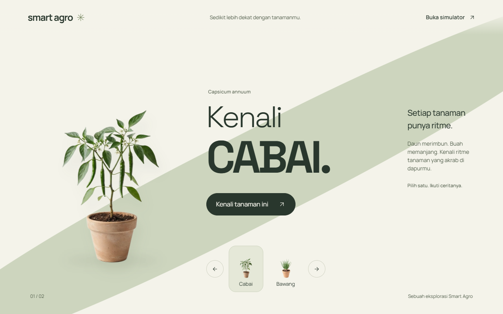
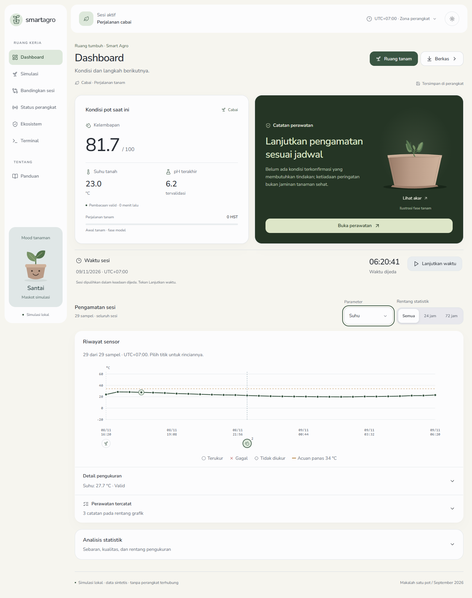
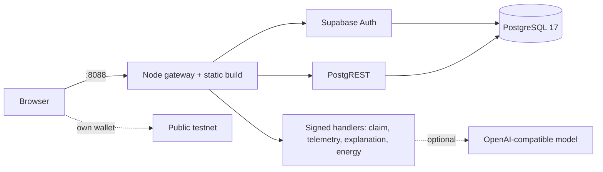

<div align="center">

# Smart Agro

**Observe the pot. Understand the evidence. Choose the next step.**

A root-zone plant-care simulator with a Supabase IoT backend: signed telemetry, product ownership, rule-based explanations, and traceable records.

[Live demo](https://smart-agro-demo.pages.dev/) · [Get started](#get-started) · [What works](#what-works) · [Architecture](#architecture) · [Changelog](CHANGELOG.md)



</div>

The interface is in Indonesian. The **[public demo](https://smart-agro-demo.pages.dev/)** serves the frontend from Cloudflare Pages and connects accounts, ownership, telemetry, transfers and rewards to hosted Supabase. The landing is public; the simulator and dashboard require sign-in. Simulator sessions stay in the browser, while account and product records use the backend. Hosted explanations use the rule engine; optional AI wording requires a server-side provider.

## Get started

With [Docker Desktop](https://www.docker.com/products/docker-desktop/) (Linux containers, Compose v2):

```sh
git clone https://github.com/Maliq-dlt/Smart-Argo.git
cd Smart-Argo
docker compose up --build -d --wait     # open http://127.0.0.1:8088
docker compose --profile tools run --rm verify   # check services, auth and access rules
docker compose stop                      # data and generated keys persist in named volumes
```

No host Node.js, Supabase account, or `.env` file is needed. Only port `8088` is published, on loopback. Sign-up is auto-confirmed in this local mode; no email is sent.

## What works

| Area | Behavior |
| --- | --- |
| Landing | Scroll story with pre-rendered device sequences (GSAP), Lenis smooth scroll, a loading curtain, and an interactive grow sequence. Reduced motion is supported throughout. |
| Simulator and dashboard | Deterministic rule engine with evidence, timestamped synthetic readings, watering/fertilizer logs, session import/export and comparison, light and dark themes. |
| Record proof | Freeze a session as exact JSON bytes, record its SHA-256 through the user's own wallet as a zero-value self-transfer on Base Sepolia or Sepolia, and verify a file against its separate proof file through the public node. |
| Product QR | Public QR holds only the serial. Scan by camera or photo (ZXing WebAssembly, self-hosted), print as SVG/PNG, and check the public registry status before signing in. |
| Accounts and ownership | A sign-in gate in front of the simulator (Google with PKCE, email and password, or guest), a profile page for account, security and products, optional authenticator-app 2FA, session-bound activation challenges with Ed25519 device proof, atomic claims, and re-authenticated one-time transfer codes. Row-level security on every table. |
| Device telemetry | Signed v2 envelopes, per-sensor quality, replay and sequence protection, explicit stale/missing readings. |
| Explanations | The rule engine decides; an optional OpenAI-compatible model (locally 9router, light Antigravity model) only rewords the result. Its text is checked (no doses, links, or markup) and labelled with model and prompt version; any failure falls back to the rule text, labelled as such. |
| Knowledge, energy, rewards | Curated immutable profile versions, signed meter windows, a transactional points ledger with reservations and compensation. |

Tests use generated keys and synthetic data. They do not prove calibration, field accuracy, physical-device integration, or energy savings. Points are internal program records, not money or tokens. Ownership and claim commitments sit in an outbox; no contract or worker sends them on-chain yet.



## Architecture



The browser receives only the API origin and the public anon key. Database passwords, JWT secrets, the service-role key, and the AI key stay on the server.

```text
src/components/        Landing, simulator, dashboard, product workspace
src/lib/               Rules, sessions, protocol clients, validation, proofs
supabase/functions/    Request handlers (Deno on Supabase, Node in the gateway)
supabase/migrations/   Schema, RLS and transactional operations
scripts/               Gateway, local launcher, Python reference
tests/                 Unit, integration, container and browser checks
```

Stack: React 18, TypeScript, Vite 6, Tailwind CSS 4, Radix UI, GSAP, Lenis, Framer Motion, Phosphor Icons, PostgreSQL 17, Supabase Auth and PostgREST.

## Local development

Node.js **22.18+**:

```sh
npm ci
npm run dev                # http://127.0.0.1:5173, simulator works without a backend
npm run backend:local      # separate terminal; Docker stack on ports 54321/54324/54325
```

The launcher writes `.env.local` only if absent. For AI explanations, create `.tmp/phase1/ai.env` (ignored by Git) before starting the backend:

```sh
AI_BASE_URL=http://127.0.0.1:20128/v1   # 9router, or any OpenAI-compatible endpoint (HTTPS unless local)
AI_API_KEY=<a key made for this app in the router dashboard>
AI_MODEL=ag/gemini-3.8-flash-low        # default
```

For Docker, pass the same variables to `docker compose up` with `AI_BASE_URL=http://host.docker.internal:20128/v1`. A hosted deployment cannot reach a router on your machine; without AI variables, explanations stay rule-based.

Google sign-in is optional. In Google Cloud Console, create an OAuth client of type *Web application* with the authorized redirect URI `http://127.0.0.1:54321/auth/v1/callback` (Docker: `http://127.0.0.1:8088/auth/v1/callback`). Put the credentials in `.tmp/phase1/google.env`, or for Docker in `.env` next to `compose.yaml` together with `GOOGLE_ENABLED=true`. Both files are ignored by Git. Then restart the backend:

```sh
GOOGLE_CLIENT_ID=<id>.apps.googleusercontent.com
GOOGLE_CLIENT_SECRET=<secret>
```

Without them, the sign-in card offers email and password only. Accounts created through Google have no password: they confirm a transfer with an authenticator code or by signing in with Google again.

For static hosting, run `npm run build` and publish `dist/`. Set `VITE_SUPABASE_URL` and `VITE_SUPABASE_ANON_KEY` at build time for online features. Never put a service-role or AI key in a `VITE_` variable.

`npm run build:cloud` builds against the hosted Supabase project in `.env.cloud` (public URL and publishable key only). That build sets `VITE_SIGN_IN_REQUIRED=true`, so the entry gate has no guest option; local builds keep it. The hosted functions accept one origin, set as the `APP_ORIGIN` secret, and have no AI key: a router on your machine is unreachable from the cloud, so explanations come from the rule engine.

### Production deployment

Pushes to `main` run the application and Docker checks. Once both pass, [Deploy Cloudflare Pages](.github/workflows/deploy-pages.yml) checks out that exact commit, runs `npm run build:cloud`, and publishes `dist/` to `smart-agro-demo.pages.dev`. The Pages project uses Direct Upload through GitHub Actions. Deployment requires the repository secret `CLOUDFLARE_API_TOKEN`, scoped to Pages Write on the configured account. No Supabase administrator credential is used by the frontend deployment.

Supabase Auth uses `https://smart-agro-demo.pages.dev` as its Site URL and permits redirects to that origin. The Edge Functions use the same origin through the server-side `APP_ORIGIN` secret. If the production domain changes, update both settings before publishing. Local redirect URLs remain available for development; the hosted functions accept only the production origin.

If building locally for production, run `npm run build:cloud`; `.env.local` points to the local backend and is ignored by Git. Do not publish a local `npm run build` result as the hosted app.

## Verification

```sh
npm run lint && npm run typecheck && npm test && npm run build
npm run test:backend       # needs npm run backend:local; synthetic fixtures only, never a shared database
npm run build:cloud && node tests/cloud-smoke.mjs  # read-only check of the public deployment after publishing
```

Browser checks use an existing Playwright install with Google Chrome (`PLAYWRIGHT_MODULE`, `TEST_URL`); see the header of each `tests/*-browser.*` file. Only Chrome has been tested.

## Documentation

- [Implementation phases and verification boundaries](docs/IMPLEMENTATION_PHASES.md)
- [Signed telemetry v2](docs/telemetry-v2.md) · [Profile curation](docs/profile-curation.md) · [Energy and rewards](docs/energy-rewards.md)
- [System diagrams and specification](docs/diagram/README.md)
- [Contributing](CONTRIBUTING.md) · [Security](SECURITY.md) · [Changelog](CHANGELOG.md) · [Credits](docs/ACKNOWLEDGMENTS.md)

Font licenses accompany the local font files. The repository does not declare a project-wide open-source license.
