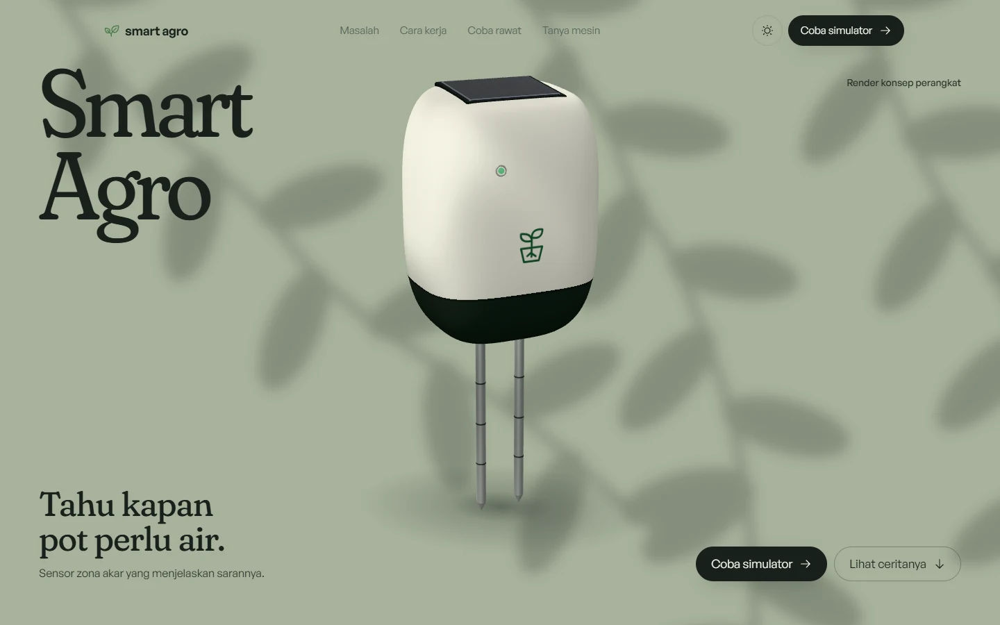
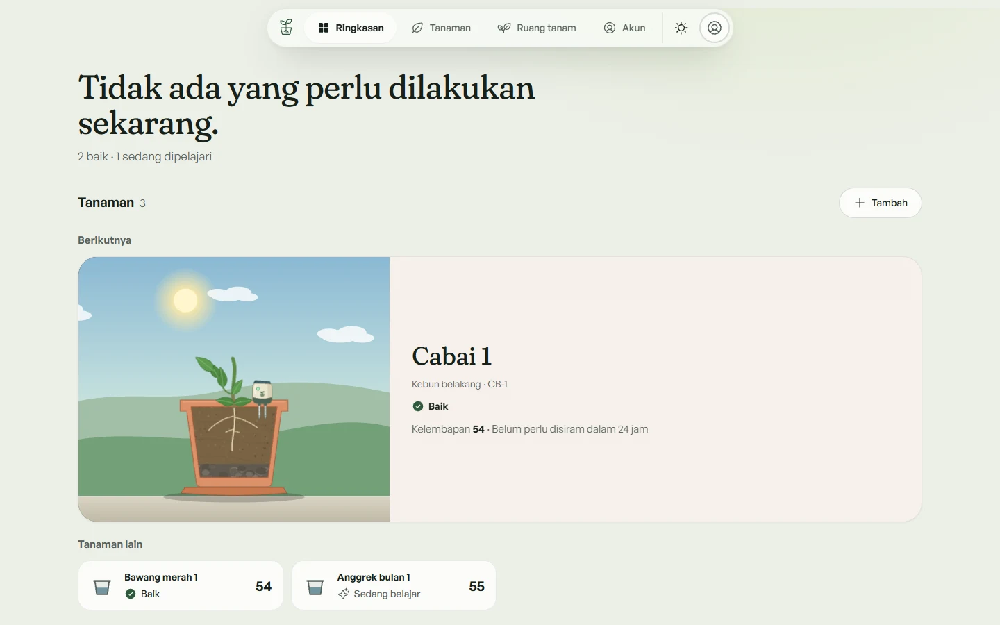
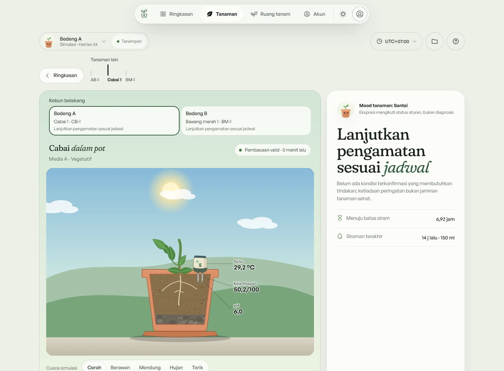
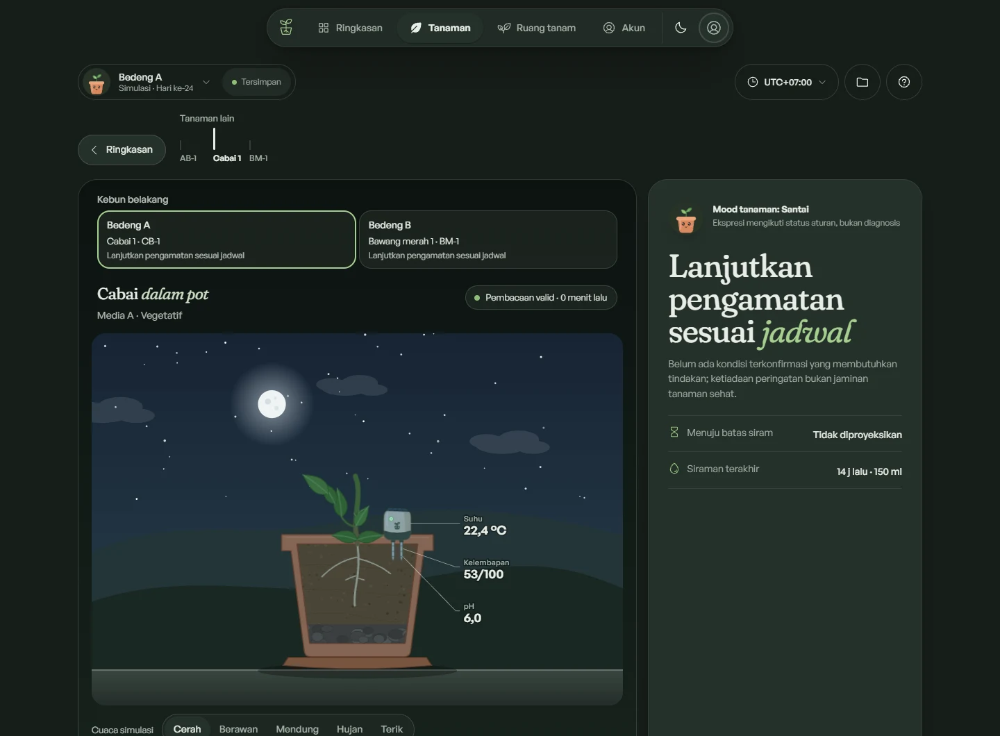
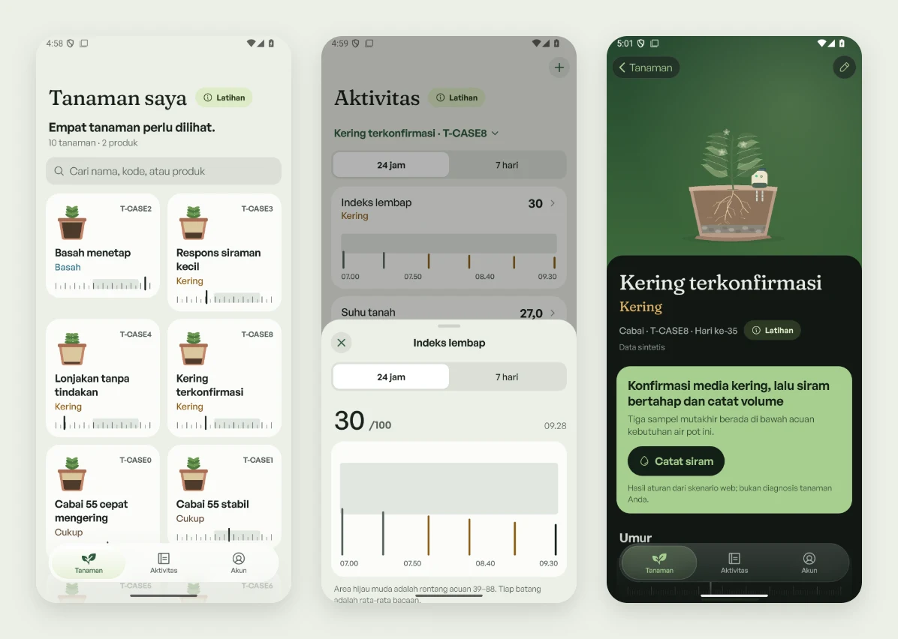
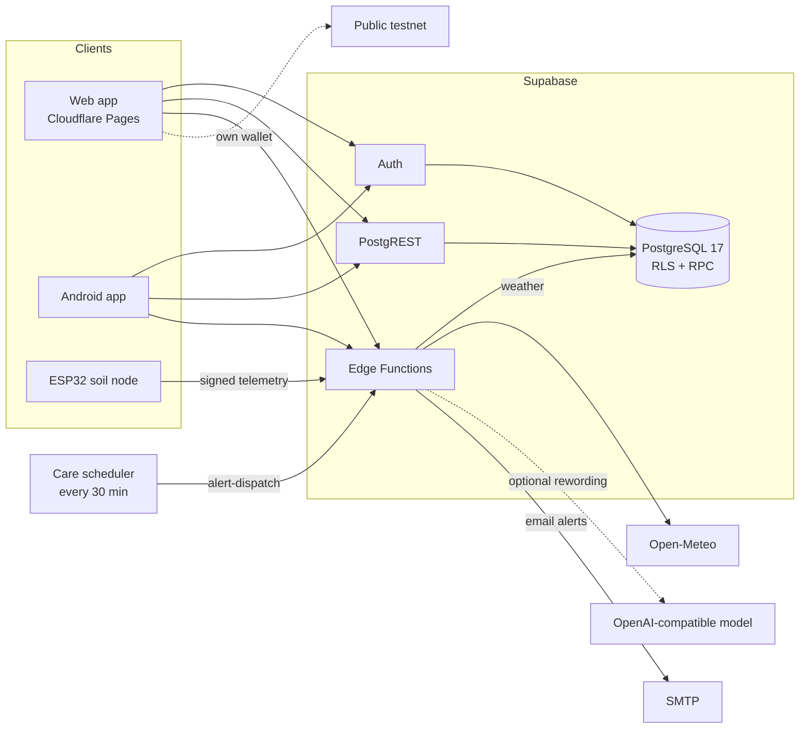

<div align="center">


# Smart Agro

**Observe the pot. Understand the evidence. Choose the next step.**

Plant care for a single pot or a small garden: an ESP32 soil node, a Supabase backend with signed telemetry,<br>
and web and Android apps that show the evidence behind every recommendation.

[](https://github.com/Maliq-dlt/Smart-Argo/actions/workflows/checks.yml)
[](https://github.com/Maliq-dlt/Smart-Argo/actions/workflows/deploy-pages.yml)
[](https://smart-agro-demo.pages.dev/)
[](https://github.com/Maliq-dlt/Smart-Argo/releases)

[Live demo](https://smart-agro-demo.pages.dev/) · [Live app](https://live.smart-agro-demo.pages.dev/) · [Android APK](https://github.com/Maliq-dlt/Smart-Argo/releases) · [Documentation](#documentation) · [Changelog](CHANGELOG.md)



</div>

> [!NOTE]
> Smart Agro is a working prototype built by a university team. The interface is in Indonesian. The web apps, backend and Android app run in production; the ESP32 node has not yet passed its [bench test](firmware/UJI-BANGKU.md) on real hardware. See [Project status](#project-status).

## Contents

- [Overview](#overview)
- [Features](#features)
- [Screenshots](#screenshots)
- [Architecture](#architecture)
- [Getting started](#getting-started)
- [Testing](#testing)
- [Deployment](#deployment)
- [Project status](#project-status)
- [Repository layout](#repository-layout)
- [Documentation](#documentation)
- [Contributing](#contributing) · [Security](#security) · [Acknowledgements](#acknowledgements) · [License](#license)

## Overview

Home growers water by habit and find out too late that the root zone was dry, waterlogged or too hot. Smart Agro measures the root zone and answers one question per plant: *what, if anything, should I do now?*

- **A deterministic rule engine decides.** Every recommendation lists the readings, limits and profile it came from. An optional language model may reword the result; it never changes the decision, and its text is checked before it is shown.
- **Readings are evidence, not decoration.** Device packets are signed (Ed25519), replay-protected and tagged with per-sensor quality. Stale, missing and failed readings are shown as such instead of being smoothed over.
- **A plant without a curated profile still gets help.** The app learns the pot's own pattern from checks and measured waterings, and says so, instead of borrowing a generic standard.

There are two web builds of the same code: the **demo**, which also offers a guest visit with a simulated pot and garden, and the **live app**, which needs a real account and shows only real data.

## Features

| Area | What it does |
| --- | --- |
| **Plant care** | Overview of every plant with one status sentence, a plant page with a cut-away pot that reacts to the readings, moisture bands from the plant's profile, a watering outlook, detected rises that were not logged, a care journal, a calendar and history charts. |
| **Garden** | Personal pots and garden zones, a searchable plant catalog, plant codes such as `CB-12`, plant changes that close a cycle and keep its history, and real weather from Open-Meteo for outdoor sites with coordinates. |
| **Learning mode** | For plants without a curated profile: after 7 days of readings, 3 checks and 2 measured waterings, the app describes the pot's own pattern and labels it as such. |
| **Alerts** | Dry soil, a silent device, frequent upload gaps and a low battery, with hysteresis. Email alerts run every 30 minutes and can be switched off per account. |
| **Device and telemetry** | ESP32 node with soil moisture, soil temperature and daily pH. Signed v2 packets, a Wi-Fi setup network without USB, battery voltage, readings that follow the pot a device is moved to, and optional INA228 energy meters. |
| **Accounts and ownership** | Email and password or Google (PKCE), email codes, authenticator-app 2FA with recovery codes, QR product claims with device proof, one-time transfer codes with a 24-hour hold after security changes, a profile photo, and account deletion with a 14-day grace period. Row-level security on every table. |
| **Records** | A session can be frozen as exact JSON bytes and its SHA-256 recorded through the user's own wallet on a public testnet. Curated plant profiles are immutable versions; points use a transactional ledger. |
| **Android app** | Native Kotlin and Jetpack Compose app with the same account, plants, care data, alerts and device setup as the web, plus an offline cache, notifications and a home-screen widget. |

## Screenshots

<table>
  <tr>
    <td width="50%"><br><sub><b>Ringkasan.</b> One sentence for every plant; the plants that need you come first.</sub></td>
    <td width="50%"><br><sub><b>Tanaman.</b> The pot reacts to soil moisture, temperature and pH, under a sky that follows the clock.</sub></td>
  </tr>
  <tr>
    <td width="50%"><br><sub><b>Dark mode.</b> Every colour comes from one token set for light and dark.</sub></td>
    <td width="50%"><br><sub><b>Android.</b> Plants, a plant's detail and its dark variant.</sub></td>
  </tr>
</table>

## Architecture



Clients receive only the API origin and the publishable key. Database passwords, JWT secrets, the service-role key, SMTP and AI credentials stay on the server. Business rules live in the database as transactional RPCs behind row-level security, so the web app, the Android app and the device all go through the same checks. Edge Functions handle the work that needs a secret or an outside service: product claims and provisioning, telemetry and energy ingest, explanations, weather, history export, MFA recovery and alert dispatch.

For local work, the same functions run inside a Node gateway in front of Supabase Auth, PostgREST and PostgreSQL in Docker.

<details>
<summary><b>Technology</b></summary>

| Layer | Stack |
| --- | --- |
| Web | React 18, TypeScript 5.9, Vite 6, Tailwind CSS 4, Radix UI, Framer Motion, Phosphor Icons; GSAP, Lenis and Three.js on the landing page |
| Backend | PostgreSQL 17, Supabase Auth (GoTrue 2.198), PostgREST 14, Supabase Edge Functions (Deno) |
| Android | Kotlin 2.2, Jetpack Compose, Haze, WorkManager; Android 8.0 (API 26) and newer |
| Firmware | ESP32-WROOM (Arduino): capacitive moisture probe, DS18B20, DS3231, pH with DMS, optional INA228 pair |
| Delivery | GitHub Actions, Cloudflare Pages, Docker Compose |

</details>

## Getting started

### Run everything with Docker

The quickest way to see the app with a working backend. Requires [Docker Desktop](https://www.docker.com/products/docker-desktop/) (Linux containers, Compose v2).

```sh
git clone https://github.com/Maliq-dlt/Smart-Argo.git
cd Smart-Argo
docker compose up --build -d --wait               # open http://127.0.0.1:8088
docker compose --profile tools run --rm verify    # check services, auth and access rules
docker compose stop                               # data and generated keys stay in named volumes
```

No Node.js, Supabase account or `.env` file is needed. Only port `8088` is published, on loopback. Sign-up is confirmed automatically in this mode, so no email is sent.

### Develop the web app

Requires Node.js **22.18** or newer.

```sh
npm ci
npm run dev                # http://127.0.0.1:5173; the guest simulator works without a backend
npm run backend:local      # in a second terminal: Supabase in Docker on 54321, 54324 and 54325
```

The launcher applies pending migrations and writes `.env.local` if it is missing.

<details>
<summary><b>Optional configuration</b>: AI wording, Google sign-in, build modes, product keys</summary>

**AI wording.** Create `.tmp/phase1/ai.env` (ignored by Git) before starting the backend. Any OpenAI-compatible endpoint works; it must use HTTPS unless it is local. Without these variables, explanations come from the rule engine.

```sh
AI_BASE_URL=http://127.0.0.1:20128/v1
AI_API_KEY=<a key made for this app>
AI_MODEL=ag/gemini-3.8-flash-low
```

For Docker, pass the same variables to `docker compose up` with `AI_BASE_URL=http://host.docker.internal:20128/v1`.

**Google sign-in.** Create an OAuth client of type *Web application* with the redirect URI `http://127.0.0.1:54321/auth/v1/callback` (Docker: `http://127.0.0.1:8088/auth/v1/callback`). Put `GOOGLE_CLIENT_ID` and `GOOGLE_CLIENT_SECRET` in `.tmp/phase1/google.env`, or for Docker in `.env` next to `compose.yaml` together with `GOOGLE_ENABLED=true`, then restart the backend. Accounts created through Google have no password; they confirm sensitive actions with an authenticator code or by signing in with Google again.

**Build modes.**

| Command | Backend | Who can enter |
| --- | --- | --- |
| `npm run build` | `VITE_SUPABASE_URL` and `VITE_SUPABASE_ANON_KEY` at build time (`.env.local` locally) | Accounts and guests |
| `npm run build:cloud` | The hosted project in `.env.cloud` (public URL and publishable key only) | Accounts and guests (the demo) |
| `npm run build:live` | public settings from `.env.cloud`, live flags from `.env.live`, optional overrides in `.env.live.local` | Accounts only; no guest visit, simulator, simulated weather or demo garden |

Never put a service-role or AI key in a `VITE_` variable, and never publish a local `npm run build` as the hosted app.

**Product keys.** Product manifests are signed with `node scripts/issuer.mjs` (`keygen <key-id>`, then `sign <key-id> <SERIAL>`). The private key and each unit's secrets stay in `.tmp/cloud/issuer/`; the public key is pinned in the `ISSUER_PUBLIC_KEYS` function secret and in `VITE_ISSUER_PUBLIC_KEYS`.

</details>

### Build the Android app

Requires JDK 21 and the Android SDK (API 36). Copy `android/local.properties.example` to `android/local.properties` and set the backend URL, then:

```sh
cd android
./gradlew testDebugUnitTest assembleDebug
```

Emulator setup, release signing and the APK checks are in [android/README.md](android/README.md). Signed APKs are published on [GitHub Releases](https://github.com/Maliq-dlt/Smart-Argo/releases).

### Flash the soil node

The node is one ESP32-WROOM DevKit with one measuring point. Wiring, calibration, provisioning with `node firmware/provision.mjs` and the Wi-Fi setup network are described in [firmware/README.md](firmware/README.md); the bill of materials is in [docs/rab](docs/rab/).

## Testing

| Suite | Command | Needs |
| --- | --- | --- |
| Lint and types | `npm run lint && npm run typecheck` | — |
| Unit | `npm test` | — |
| Backend integration | `npm run test:backend` | `npm run backend:local` |
| Browser | `node tests/<name>-browser.mjs` | Playwright with Google Chrome, a preview server (see each file's header) |
| Containers | `docker compose --profile tools run --rm verify` | The Docker stack |
| Android | `./gradlew testDebugUnitTest lintDebug` (in `android/`) | JDK 21 |
| Production smoke | `npm run build:cloud && node tests/cloud-smoke.mjs` | A published deployment; read-only |

Integration tests create their own synthetic accounts and devices on a local database and never touch a shared one. Generated keys and synthetic data do not prove sensor calibration, field accuracy or energy savings. Browser checks run in Chrome only.

## Deployment

Every pull request and every push to `main` runs [Checks](.github/workflows/checks.yml): the web application, the Docker images, the backend suite and the Android build. When Checks pass on `main`, [Deploy Cloudflare Pages](.github/workflows/deploy-pages.yml) builds that exact commit twice and publishes:

| Site | Build | Address |
| --- | --- | --- |
| Demo | `npm run build:cloud` | https://smart-agro-demo.pages.dev |
| Live app | `npm run build:live` | https://live.smart-agro-demo.pages.dev |

`tests/cloud-smoke.mjs` then checks both sites and every Edge Function. The workflow needs the repository secret `CLOUDFLARE_API_TOKEN` (Pages Write). The frontend deployment uses no Supabase administrator credential.

Database migrations and Edge Functions are released by a maintainer with the Supabase CLI, after a backup:

```sh
npx supabase db push --remote=<project-ref>
npx supabase functions deploy <name> --use-api --remote=<project-ref>
```

The hosted functions accept the origins listed in the `APP_ORIGIN` secret (the demo and the live app), and Supabase Auth allows redirects to the same origins. Update both before changing a domain.

The [care alerts workflow](.github/workflows/care-alerts.yml) requests a check every 30 minutes. GitHub can delay scheduled runs. For production, the [Supabase Cron setup](docs/sensor-care-api.md) runs the schedule in the project database. Both schedulers call the `alert-dispatch` function, which also removes accounts whose deletion grace period has ended. The GitHub job is enabled by the repository variable `SMART_AGRO_MAINTENANCE_ENABLED=true` and needs the variable `SUPABASE_URL` and the secret `ALERT_DISPATCH_SECRET`, which must match the function secret of the same name.

## Project status

| Status | Features |
| --- | --- |
| **Active** | Web apps, accounts, telemetry ingest, sensor care (overview, watering outlook, alerts), the Android app. |
| **Frozen** | Energy rewards, on-chain record proofs, community knowledge, operator and curator workspaces. They are maintained and tested, but get no new features until a physical node passes the [bench test](firmware/UJI-BANGKU.md). |
| **Not yet proven** | A physical ESP32 end to end, sensor calibration in real soil, and email delivery from the alert function in production. |

Points are internal program records, not money or tokens. Ownership and claim commitments wait in an outbox; no contract sends them on-chain yet.

## Repository layout

```text
src/                   Web app: landing, simulator, dashboard, account and product screens
  components/          React components (dashboard/, plantScene/, garden/, overview/, landing/, device/, ui/)
  lib/                 Rule engine, sessions, garden and species catalog, API clients, validation, proofs
supabase/
  migrations/          Schema, row-level security and transactional RPCs
  functions/           Edge Functions (Deno), shared with the local Node gateway
  templates/           Branded Indonesian email templates for Supabase Auth
android/               Native Android app (Kotlin, Jetpack Compose)
firmware/              ESP32 soil node, provisioning script and bench test
scripts/               Local gateway and launcher, issuer, backups, email and asset tools
tests/                 Unit, integration, container and browser checks
docs/                  API contracts, operations, diagrams, audits and plans
public/                Fonts, landing media, privacy page, security headers
```

## Documentation

| Topic | Documents |
| --- | --- |
| Product | [Product principles](PRODUCT.md) · [Implementation phases](docs/IMPLEMENTATION_PHASES.md) · [System diagrams](docs/diagram/README.md) |
| API contracts | [Sensor care](docs/sensor-care-api.md) · [Care history](docs/care-history-api.md) · [Device lifecycle](docs/device-lifecycle-api.md) · [Telemetry v2](docs/telemetry-v2.md) · [Telemetry v1 files](docs/telemetry-v1.md) |
| Domain | [Profile curation](docs/profile-curation.md) · [Energy and rewards](docs/energy-rewards.md) · [Weather](docs/cuaca.md) |
| Operations | [Backend operations](docs/backend-operations.md) · [Privileged access](docs/privileged-access.md) · [SMTP setup](docs/panduan-smtp.md) · [Play data safety](docs/play-data-safety.md) |
| Hardware | [Firmware](firmware/README.md) · [Bench test](firmware/UJI-BANGKU.md) · [Bill of materials](docs/rab/) |
| Reviews | [Audits](docs/audits/) · [Design specs](docs/superpowers/specs/) and [plans](docs/superpowers/plans/) |

Some operational guides are written in Indonesian, like the interface.

## Contributing

Contributions are welcome. Read [CONTRIBUTING.md](CONTRIBUTING.md) before opening a pull request: it covers the local setup, the checks every change must pass, and the extra care that data, protocol and migration changes need.

Bugs and ideas go to [GitHub Issues](https://github.com/Maliq-dlt/Smart-Argo/issues).

## Security

Please do not report vulnerabilities in public issues. [SECURITY.md](SECURITY.md) explains how to report one and describes the security model: authentication, sessions and 2FA, device proof, row-level security and the limits of what is verified.

## Acknowledgements

Smart Agro builds on open fonts, open media and open-source components; see [docs/ACKNOWLEDGMENTS.md](docs/ACKNOWLEDGMENTS.md). Weather data by [Open-Meteo](https://open-meteo.com/).

## License

The repository does not declare a project-wide open-source license, so all rights are reserved by the authors. Font licenses accompany the font files in `public/fonts/`, and third-party components keep their own licenses.
